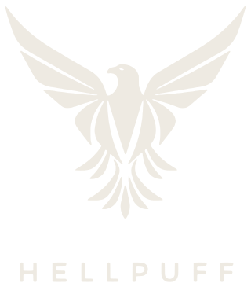
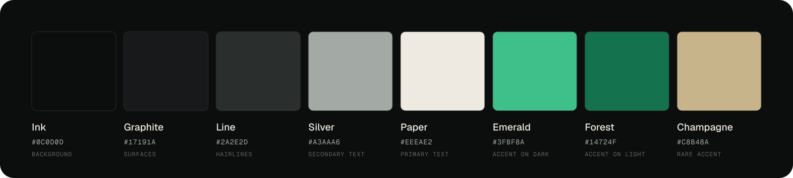
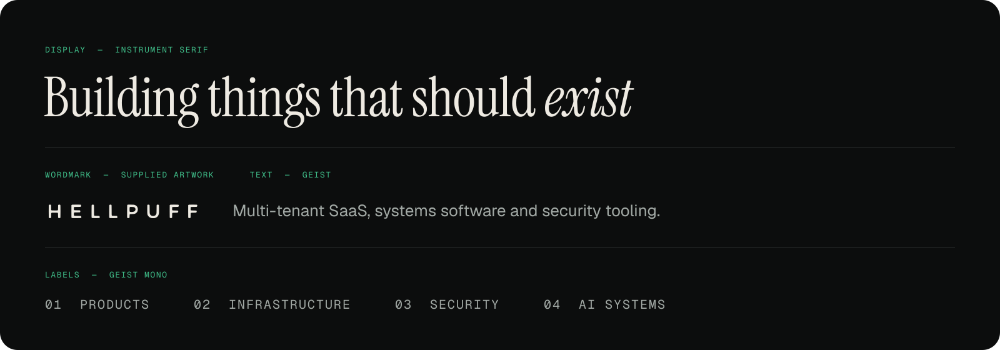

# hellpuff brand guide

A small identity system for GitHub, [hellpuff.dev](https://www.hellpuff.dev) and anything else I publish.
Every asset in `assets/` is generated from `tools/build-brand.mjs`, so changes start there.

## The logo

The logo is an eagle with raised wings above the word **HELLPUFF** in widely spaced capitals. It comes from the
supplied artwork (white on charcoal); `tools/lib/logo.mjs` holds a vector trace of it, checked against the
original at source size: 97.9% pixel overlap for the full lockup, including the eye. If the original vector
file turns up, it replaces the trace and every asset regenerates from it.

- **Stacked lockup** (eagle above the wordmark) is the only combined arrangement, spaced exactly as in the
  supplied artwork. Small placements use the eagle alone.
- The eagle is always one flat colour: Paper on dark, Ink on light. No outlines, gradients or effects.
- Keep clear space of at least a quarter of the eagle's width around it.

| File | Use |
| :-- | :-- |
| `hellpuff-logo.svg`, `hellpuff-logo-ink.svg` | Stacked lockup, dark and light backgrounds |
| `hellpuff-mark.svg`, `hellpuff-mark-ink.svg` | The eagle alone |
| `hellpuff-wordmark.svg`, `hellpuff-wordmark-ink.svg` | The wordmark alone |
| `hellpuff-avatar.svg`, `hellpuff-avatar.png` | Square avatar, wingtips safe inside a circle crop (1024 × 1024 PNG) |
| `hellpuff-animation.svg`, `hellpuff-animation-static.svg` | A quiet fade-in reveal and its static frame |
| `hellpuff-banner.svg`, `hellpuff-banner-static.svg`, `hellpuff-banner.png` | Profile header and static fallbacks |
| `hellpuff-social-preview.svg`, `hellpuff-social-preview.png` | Repository social preview, 1280 × 640 |

## Colour



Dark first. Ink carries the page, Paper carries the words, and Emerald is a signal, not a fill: one full stop,
one rule, one link per view. Forest replaces Emerald on light backgrounds. Champagne is close to the accent on
hellpuff.dev and is kept for rare use.

## Typography



| Role | Typeface | Notes |
| :-- | :-- | :-- |
| Display | Instrument Serif | Headlines only. Italic for the one word that matters. |
| Wordmark | The supplied HELLPUFF artwork | Never re-set in a typeface |
| Text | Geist | |
| Labels | Geist Mono | Uppercase, tracking +10–14%, numbered `01 02 03` |

Both families are licensed under the SIL Open Font License. In SVGs used on GitHub, all type is converted to
outlines, because images embedded in a README cannot load web fonts.

## Motion

One controlled reveal: the logo fades in and settles. Every animated SVG honours `prefers-reduced-motion` and falls back to its final
frame, and the README swaps in the static banner through `<picture>` for visitors who ask for less motion.

## Regenerating

```sh
cd tools
npm install
node fetch-fonts.mjs     # Instrument Serif from google/fonts
npm run brand            # every SVG and PNG in assets/, plus the README project index
npm run inventory        # PROJECTS.md and the language strip
npm run check            # validates SVGs, local links and image references
```
