<picture>
  <source media="(prefers-reduced-motion: reduce)" srcset="assets/hellpuff-banner-static.svg">
  
</picture>

 

**Software engineer in Nepal.** I build products for real businesses, and the systems underneath them from scratch.

[**hellpuff.dev ↗**](https://www.hellpuff.dev) &nbsp;·&nbsp; [Work](https://www.hellpuff.dev/work) &nbsp;·&nbsp; [CV](https://www.hellpuff.dev/cv)

 

<picture>
  <source media="(prefers-color-scheme: dark)" srcset="assets/section-stack-dark.svg">
  
</picture>

<picture>
  <source media="(prefers-color-scheme: dark)" srcset="assets/stack-dark.svg">
  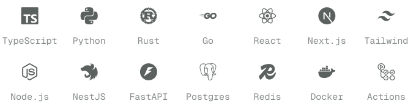
</picture>

What each one is based on → [SKILLS.md](SKILLS.md)

 

<picture>
  <source media="(prefers-color-scheme: dark)" srcset="assets/section-showcase-dark.svg">
  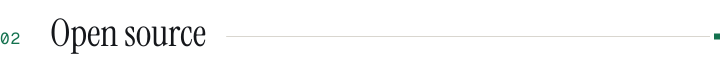
</picture>

Real screenshots of each project running locally on bundled or synthetic data.

<!-- work:showcase:start -->
<table>
<tr>
<td width="50%" valign="top">
<a href="https://www.hellpuff.dev/work/architectflow">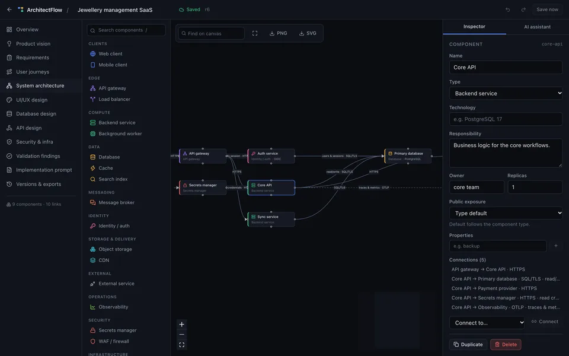</a> 
<b>ArchitectFlow</b> &nbsp;EXPERIMENTAL 
Design a system&#x27;s architecture, data model, API and UI as one versioned document, check it with deterministic rules, and generate an implementation prompt from the exact saved revision. 
<a href="https://www.hellpuff.dev/work/architectflow">Case study</a> &nbsp;·&nbsp; <a href="https://github.com/hellpuffyt/ArchitectFlow">Source</a>
</td>
<td width="50%" valign="top">
<a href="https://www.hellpuff.dev/work/statuscraft">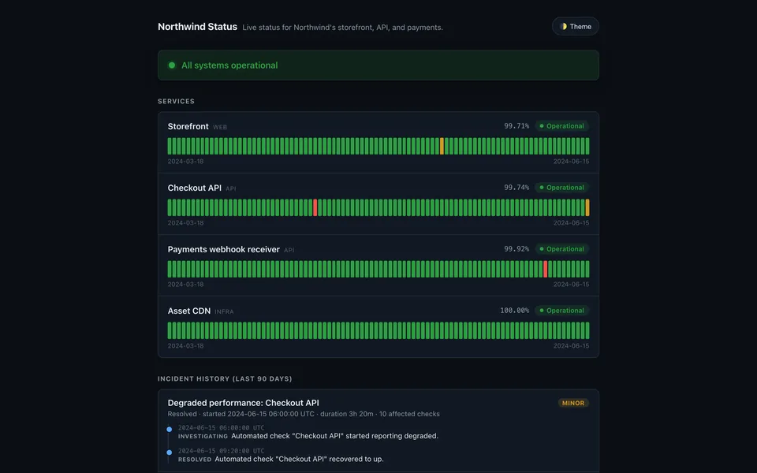</a> 
<b>Statuscraft</b> &nbsp;IN DEVELOPMENT 
A status page generator that refuses to lie: every status, badge and incident is computed from an append-only log of real synthetic-check results. 
<a href="https://www.hellpuff.dev/work/statuscraft">Case study</a> &nbsp;·&nbsp; <a href="https://github.com/hellpuffyt/statuscraft">Source</a>
</td>
</tr>
<tr>
<td width="50%" valign="top">
<a href="https://www.hellpuff.dev/work/repograph">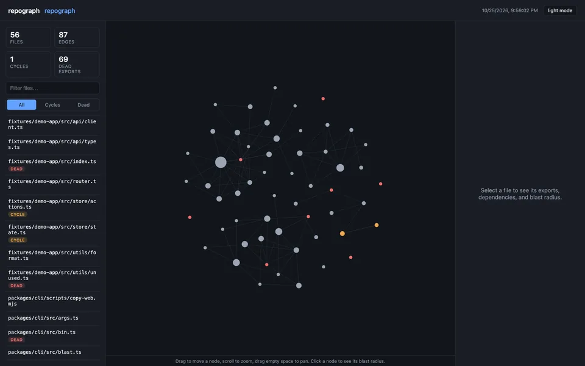</a> 
<b>RepoGraph</b> &nbsp;IN DEVELOPMENT 
An interactive dependency map for TypeScript and JavaScript codebases: import cycles, dead exports, API surface and click-to-highlight blast radius in one HTML file. 
<a href="https://www.hellpuff.dev/work/repograph">Case study</a> &nbsp;·&nbsp; <a href="https://github.com/hellpuffyt/repograph">Source</a>
</td>
<td width="50%" valign="top">
<a href="https://www.hellpuff.dev/work/waterfall-lens">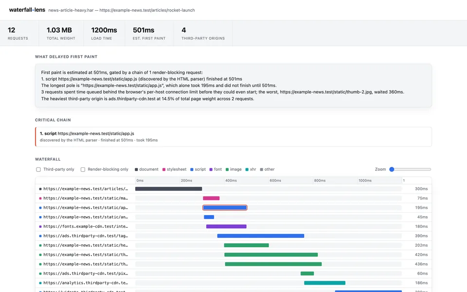</a> 
<b>Waterfall Lens</b> &nbsp;IN DEVELOPMENT 
Turns a HAR capture into an answer: the critical rendering chain, connection queuing and third-party weight, explained in plain English beside an interactive waterfall. 
<a href="https://www.hellpuff.dev/work/waterfall-lens">Case study</a> &nbsp;·&nbsp; <a href="https://github.com/hellpuffyt/waterfall-lens">Source</a>
</td>
</tr>
<tr>
<td width="50%" valign="top">
<a href="https://www.hellpuff.dev/work/modelharbor">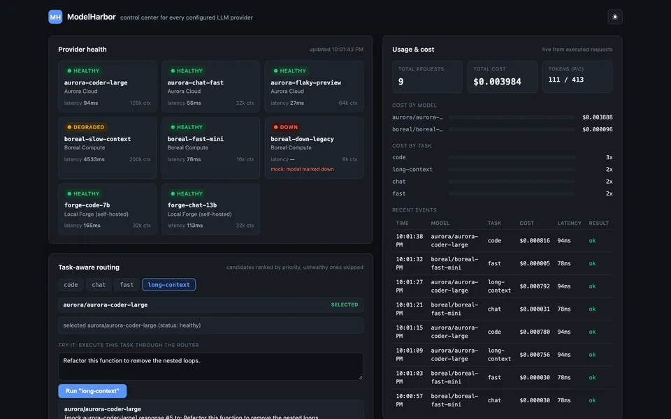</a> 
<b>ModelHarbor</b> &nbsp;IN DEVELOPMENT 
A self-hosted dashboard for every configured LLM provider: live health and latency per model, task-aware routing with live failover, and a usage-cost ledger. 
<a href="https://www.hellpuff.dev/work/modelharbor">Case study</a> &nbsp;·&nbsp; <a href="https://github.com/hellpuffyt/modelharbor">Source</a>
</td>
<td width="50%" valign="top">
<a href="https://www.hellpuff.dev/work/emberline-engine">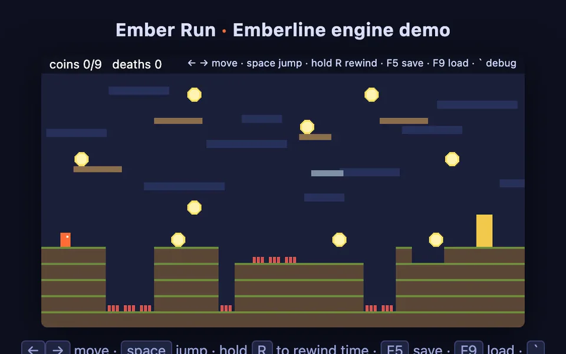</a> 
<b>Emberline</b> &nbsp;RESEARCH 
A 2D game engine where time is a data structure: fixed-step deterministic simulation, hold-to-rewind, replays and save files that are verifiable input logs. 
<a href="https://www.hellpuff.dev/work/emberline-engine">Case study</a> &nbsp;·&nbsp; <a href="https://github.com/hellpuffyt/emberline-engine">Source</a>
</td>
</tr>
</table>
<!-- work:showcase:end -->

 

<picture>
  <source media="(prefers-color-scheme: dark)" srcset="assets/section-products-dark.svg">
  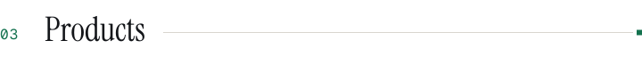
</picture>

Private codebases. Each row opens the public site or the case study.

<!-- work:products:start -->
<a href="https://datajewellers.com">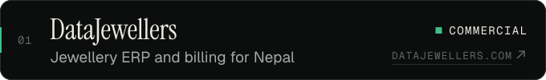</a> 
<a href="https://datarestro.com">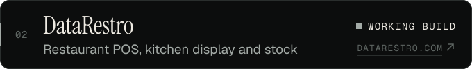</a> 
<a href="https://dataudaan.com">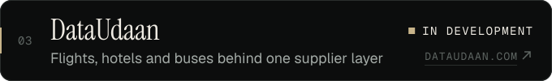</a> 
<a href="https://dataaccommodation.com">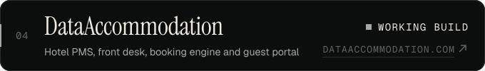</a> 
<a href="https://www.hellpuff.dev/work/dataitemize">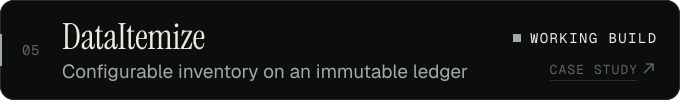</a> 
<a href="https://www.hellpuff.dev/work/timetravel">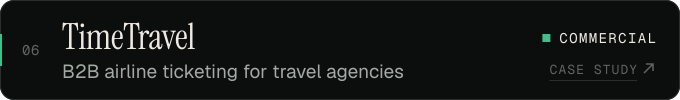</a> 
<a href="https://www.sitashreejewellers.com">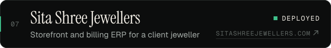</a>
<!-- work:products:end -->

 

<picture>
  <source media="(prefers-color-scheme: dark)" srcset="assets/section-systems-dark.svg">
  
</picture>

Open source unless the row says case study.

<!-- work:systems:start -->
<a href="https://github.com/hellpuffyt/vercel-slm">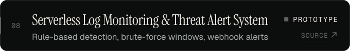</a> 
<a href="https://github.com/hellpuffyt/eBPF-KernelTrace-MCP">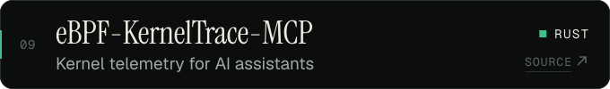</a> 
<a href="https://github.com/hellpuffyt/Titan-HFT">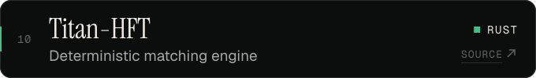</a> 
<a href="https://github.com/hellpuffyt/ChaosProxy-L7">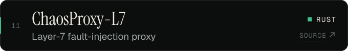</a> 
<a href="https://github.com/hellpuffyt/bellows-compiler">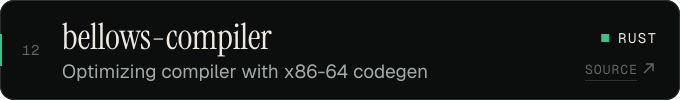</a> 
<a href="https://github.com/hellpuffyt/tesseradb">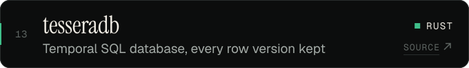</a> 
<a href="https://github.com/hellpuffyt/halyard-vm">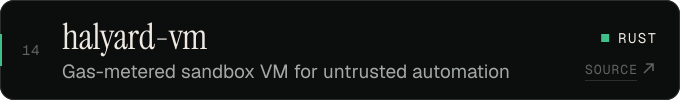</a> 
<a href="https://github.com/hellpuffyt/tarn-lang">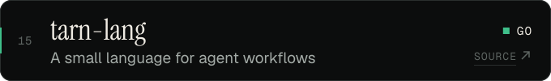</a> 
<a href="https://github.com/hellpuffyt/spindrift">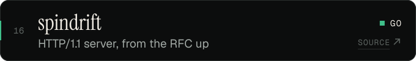</a> 
<a href="https://github.com/hellpuffyt/modelharbor">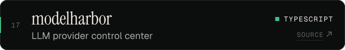</a>
<!-- work:systems:end -->

<picture>
  <source media="(prefers-color-scheme: dark)" srcset="assets/languages-dark.svg">
  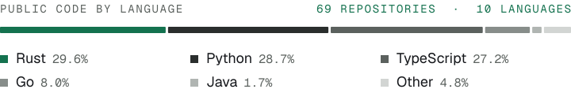
</picture>

Every public repository, grouped → [PROJECTS.md](PROJECTS.md)

 

<picture>
  <source media="(prefers-color-scheme: dark)" srcset="assets/section-focus-dark.svg">
  
</picture>

- Multi-tenant SaaS that stays simple as it grows
- Authorization at the API boundary, never in the browser
- Agents that touch real systems, with policy and replay
- Interfaces that make heavy operations feel calm

 

<a href="https://www.hellpuff.dev">
  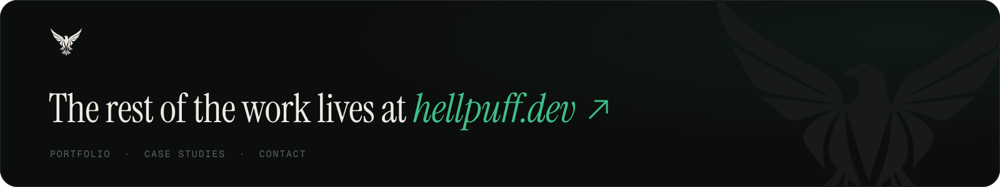
</a>

<a href="BRAND.md">brand</a>

